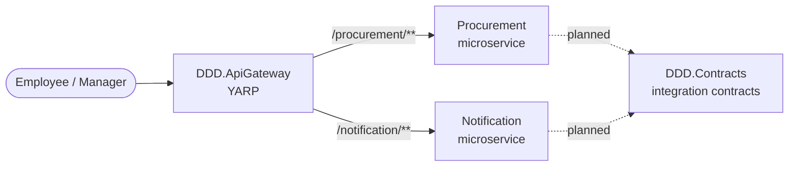
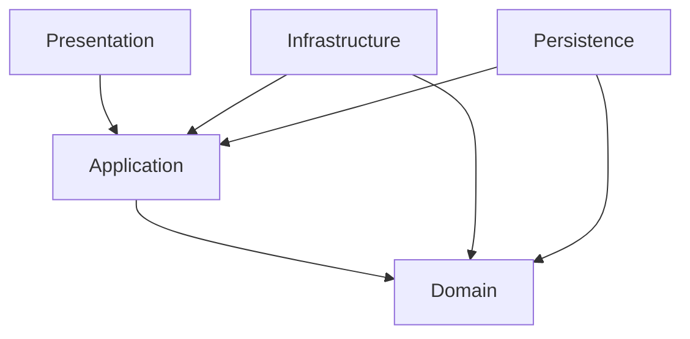

# System Overview

Status: verified against the repository as of this document's creation.
Solution file: `DDD.slnx` (no classic `DDD.sln`).

## Business purpose

Mini Procurement: an employee creates a **purchase request** containing one or
more **items**; the request is submitted to the requester's **department
manager**, who approves it, finally rejects it, or returns it for correction. A
returned request can be corrected and resubmitted.

## System context



The gateway routes are configured in `src/ApiGateway/DDD.ApiGateway/appsettings.json`
(`procurement-cluster` → `http://localhost:5101/`, `notification-cluster` →
`http://localhost:5102/`). **Operational end-to-end gateway verification has not
been performed** — it is structural configuration only.

## Main components

| Component | Path | Responsibility | State |
| --- | --- | --- | --- |
| Procurement | `src/Services/Procurement` | Purchase request capability | Domain + one use case implemented |
| Notification | `src/Services/Notification` | Outbound notifications | Scaffolding only |
| DDD.ApiGateway | `src/ApiGateway/DDD.ApiGateway` | YARP reverse proxy | Configured, not operationally verified |
| DDD.Contracts | `src/BuildingBlocks/DDD.Contracts` | Cross-service integration contracts | Empty (by design) |

## Procurement and Notification boundaries

- Each service owns its own domain; there is **no shared domain project** and
  **no Domain-to-Domain reference** between the services.
- `DDD.Contracts` is reserved for integration contracts and must not become a
  place to share Domain entities.

## Layered architecture



Per-service layout:

```
src/Services/<Service>/
  <Service>.Domain
  <Service>.Application
  <Service>.Infrastructure
  <Service>.Persistence
  <Service>.Presentation    (composition root)
```

Dependency direction rules (enforced by architecture tests):

1. `Domain` has no project references and no ASP.NET Core / EF Core / Npgsql / YARP dependency.
2. `Application` references `Domain` only.
3. `Infrastructure` and `Persistence` reference `Domain` and `Application`.
4. `Presentation` references `Application`, `Infrastructure`, `Persistence`.

## Current vs planned capabilities

| Capability | State |
| --- | --- |
| Procurement domain model + rules | Implemented & verified |
| `CreatePurchaseRequest` HTTP → Application → Domain | Implemented & verified |
| Layered structure & dependency direction | Implemented & verified (architecture tests) |
| Persistence (EF Core/PostgreSQL) | Planned — projects scaffolded, no code |
| Submit / Approve / Reject / Return endpoints | Planned |
| Approver resolution from organization data | Not implemented (approver is a temporary input) |
| Notification business logic | Not implemented |
| Messaging / integration events | Planned (no ADR yet) |
| Authentication / authorization | Planned (no ADR yet) |
| Observability, Docker, Gateway auth | Planned |

See `docs/architecture/current-state.md` for the detailed, maintained status.

## Related documents

- Decisions: `docs/architecture/decisions/`
- Business rules: `docs/domain/business-rules.md`
- Vocabulary: `docs/domain/ubiquitous-language.md`
- Domain model detail: `docs/architecture/domain-model-v0.2.md`
- Verification reports: `docs/architecture/chat-01-final-review.md`, `docs/architecture/chat-01-audit-report.md`
